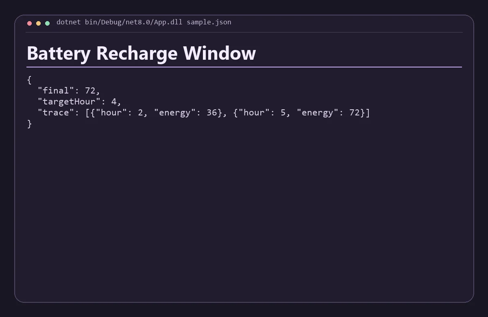

# Battery Recharge Window

Simulate battery recharge through a schedule of charger and background loads.



## Run

Install .NET 8 SDK and runtime. Run these commands from the repository root.

```sh
dotnet build --nologo
dotnet bin/Debug/net8.0/App.dll sample.json
```

Replace `sample.json` with a JSON file following the same structure. The app prints a JSON report to standard output.

Use whole or decimal watt-hours and segment triples [hours, charge watts, load watts]. Each segment has a constant net rate. Energy stays between zero and capacity.

## Verify

Run `python check.py` with Python 3.11 or newer after the build step when applicable. The check verifies the bundled scenario and confirms that an invalid input returns an error.
